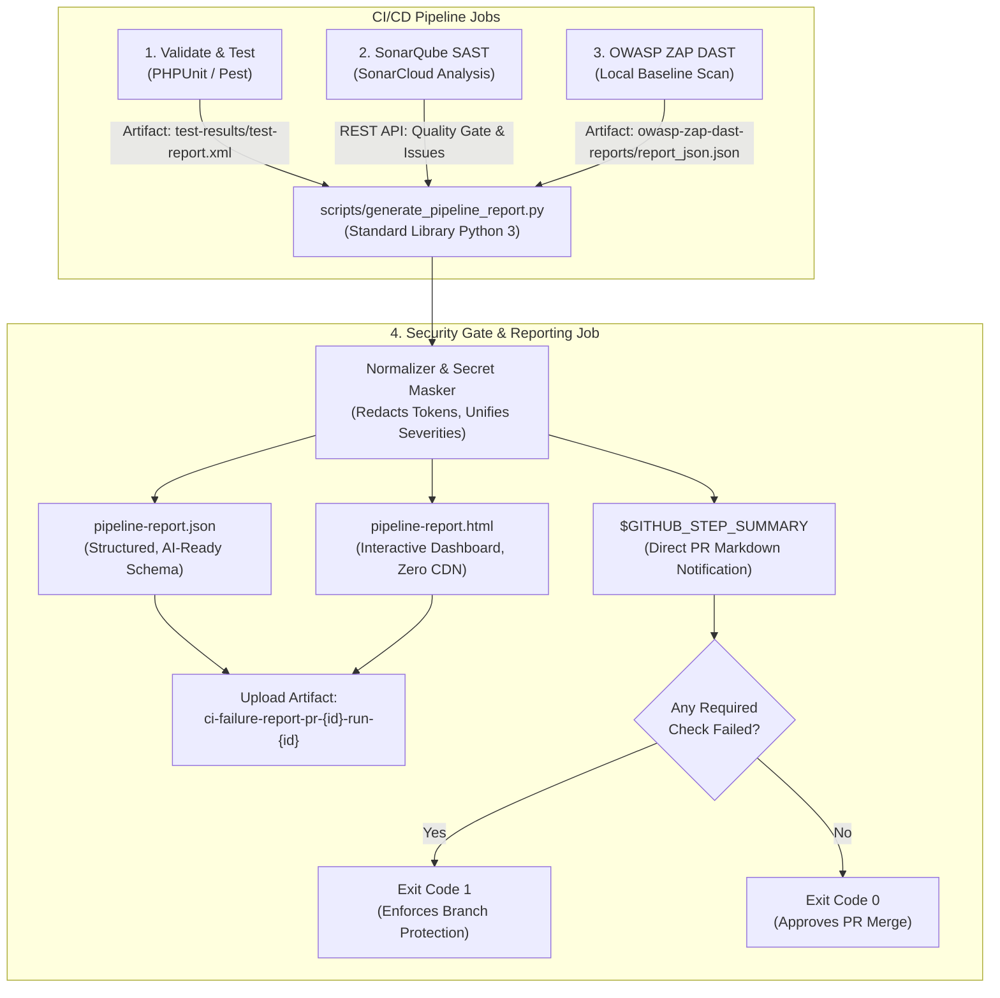

# CI/CD Failure Reporting & AI-Ready Analysis System

This documentation provides an in-depth reference for the automated failure reporting system integrated into the GitHub Actions CI/CD security pipeline. The system aggregates SonarQube Cloud SAST results, OWASP ZAP DAST findings, JUnit test failures, and GitHub Actions job statuses into both an interactive developer HTML dashboard and an AI-ready normalized JSON report.

---

## Table of Contents

1. [Architecture Overview](#1-architecture-overview)
2. [Workflow Execution Sequence](#2-workflow-execution-sequence)
3. [Data Collection Mechanisms](#3-data-collection-mechanisms)
4. [Normalized Report Structure & JSON Schema](#4-normalized-report-structure--json-schema)
5. [HTML Developer Dashboard Features](#5-html-developer-dashboard-features)
6. [How to Download & View Reports](#6-how-to-download--view-reports)
7. [GitHub Actions Workflow Configuration](#7-github-actions-workflow-configuration)
8. [Multi-Repository Reusability](#8-multi-repository-reusability)
9. [Security & Data Privacy](#9-security--data-privacy)
10. [Future AI Code-Fix Agent Integration](#10-future-ai-code-fix-agent-integration)
11. [Troubleshooting](#11-troubleshooting)

---

## 1. Architecture Overview

The reporting system runs within the `security_gate` job of the CI/CD pipeline. When any check fails (or upon pipeline completion), it gathers data from all upstream stages, processes it using a lightweight Python engine (`scripts/generate_pipeline_report.py`), and publishes unified artifacts.



---

## 2. Workflow Execution Sequence

1. **Job 1 (Validate & Test)**: Runs linter and unit tests. Outputs a standard JUnit XML file (`test-report.xml`) and uploads it as the `test-results` artifact with `if: always()`.
2. **Job 2 (SonarQube Cloud SAST)**: Scans source code and waits for the SonarQube Cloud Quality Gate to evaluate.
3. **Job 3 (OWASP ZAP DAST)**: Starts the application in the background, waits for readiness via health checks (`/up`), runs passive DAST scanning, and uploads `owasp-zap-dast-reports` with `if: always()`.
4. **Job 4 (Security Gate & Report Generator)**:
   - Configured with `needs: [validate, sonar_sast, dast_zap]` and `if: always()`.
   - Checks out repository source code to obtain `scripts/generate_pipeline_report.py`.
   - Downloads upstream artifacts (`test-results`, `owasp-zap-dast-reports`).
   - Queries the SonarQube Cloud REST API for real-time Quality Gate metrics and issue lists.
   - Executes `generate_pipeline_report.py` to generate `pipeline-report.json` and `pipeline-report.html`.
   - Uploads the consolidated reports as a named artifact (`ci-failure-report-pr-${PR}-run-${RUN_ID}`).
   - Formats a clear summary in `$GITHUB_STEP_SUMMARY`.
   - **Enforces pipeline status**: If any required check failed, exits with code 1 so branch protection rules remain enforced.

---

## 3. Data Collection Mechanisms

### 3.1 GitHub Actions Context
- **Run Metadata**: Workflow name, Run ID, Attempt number, Run URL, Commit SHA, Branch name, Pull Request number, and timestamp.
- **Job Statuses**: Captures the exact outcome (`success`, `failure`, `cancelled`, `skipped`) of each upstream job and step.

### 3.2 SonarQube Cloud REST API
The collector queries SonarCloud API endpoints using standard HTTP requests:
- **Quality Gate Status**: `GET /api/qualitygates/project_status?projectKey={key}&pullRequest={pr}`
  - Captures failed metrics (`new_security_rating`, `new_reliability_rating`, `new_coverage`, etc.), comparison operators, actual values, and required thresholds.
  - Generates plain-language explanations (e.g. *"Security Rating is D (required: grade A). Critical or high vulnerabilities detected."*).
- **Issues Search**: `GET /api/issues/search?projects={key}&pullRequest={pr}&statuses=OPEN,REOPENED,CONFIRMED`
  - Captures rule ID, severity, message, file component, and line number.
- **Security Hotspots**: `GET /api/hotspots/search?projectKey={key}&pullRequest={pr}`
  - Captures unreviewed security hotspots and vulnerability probability.

### 3.3 OWASP ZAP
- Parses `report_json.json` generated by the Baseline scan.
- Normalizes risk codes:
  - `3` $\to$ **HIGH**
  - `2` $\to$ **MEDIUM**
  - `1` $\to$ **LOW**
  - `0` $\to$ **INFORMATIONAL**
- Extracts affected URLs, HTTP methods, CWE identifiers, WASC identifiers, evidence snippets, and solution advice.

### 3.4 Test Suite Failures (JUnit XML)
- Parses standard JUnit XML elements (`<failure>`, `<error>`).
- Extracts test suite classname, test case name, failure message, stack trace, and execution duration.

---

## 4. Normalized Report Structure & JSON Schema

The generated `pipeline-report.json` follows a strict schema designed for programmatic parsing by AI agents:

```json
{
  "$schema": "https://json-schema.org/draft/2020-12/schema",
  "report_version": "1.0.0",
  "generated_at": "2026-11-23T08:35:00Z",
  "repository": {
    "name": "Team3-SE/Concert-Ticket-System",
    "url": "https://github.com/Team3-SE/Concert-Ticket-System"
  },
  "workflow": {
    "name": "Security CI Pipeline",
    "run_id": "195829140",
    "run_url": "https://github.com/Team3-SE/Concert-Ticket-System/actions/runs/195829140",
    "status": "failure",
    "conclusion": "failure"
  },
  "pull_request": {
    "number": 3,
    "head_branch": "feature/payments-gateway-system",
    "base_branch": "main",
    "url": "https://github.com/Team3-SE/Concert-Ticket-System/pull/3"
  },
  "commit": {
    "sha": "c62023cef1e0b388e5403aa7d71f6b9d8f555bd4",
    "short_sha": "c62023c"
  },
  "summary": {
    "overall_status": "FAILED",
    "total_findings": 36,
    "critical": 2,
    "high": 27,
    "medium": 1,
    "low": 6,
    "informational": 0,
    "failed_tests": 1,
    "failed_jobs": 3,
    "quality_gate_status": "ERROR"
  },
  "quality_gate": {
    "status": "ERROR",
    "project_key": "Team3-SE_Concert-Ticket-System",
    "organization": "team3-se",
    "conditions": [
      {
        "metric_key": "new_security_rating",
        "status": "ERROR",
        "comparator": "GT",
        "threshold": "1",
        "actual_value": "4",
        "explanation": "Security Rating is D (required: grade A)."
      }
    ]
  },
  "failed_jobs": [ ... ],
  "failed_tests": [ ... ],
  "security_scan": { ... },
  "findings": [
    {
      "id": "sonar-AZ...1",
      "source": "sonarqube",
      "category": "vulnerability",
      "severity": "CRITICAL",
      "rule_id": "docker:S6470",
      "title": "[CRITICAL] docker:S6470: Copying using a glob pattern...",
      "message": "Copying using a glob pattern might inadvertently add sensitive data to the container.",
      "file": "Dockerfile",
      "line": 23,
      "remediation": "Specify explicit files or ensure .dockerignore is configured.",
      "ai_context": {
        "actionable": true,
        "fix_priority": "P0",
        "suggested_file": "Dockerfile",
        "suggested_action": "modify_file"
      }
    }
  ],
  "ai_analysis_ready": {
    "ready": true,
    "recommended_agent_role": "Security Remediation & Automated Bug Fixing Specialist",
    "primary_targets": [
      {
        "file": "Dockerfile",
        "issue_count": 4,
        "highest_severity": "CRITICAL",
        "summary": "Resolve 4 issues (docker:S6471, docker:S8546, docker:S6470)"
      }
    ],
    "prompt_summary": "You are an expert software engineer tasked with fixing CI/CD pipeline failures..."
  }
}
```

---

## 5. HTML Developer Dashboard Features

The HTML report (`pipeline-report.html`) is a standalone single-page application built with vanilla HTML/CSS/JavaScript:

1. **Zero External Dependencies**: Works 100% offline without external fonts, Google Fonts, or CDN scripts.
2. **Status Banner & KPI Summary Cards**: Instant visibility into total issues, Critical/High counts, failed test counts, and Quality Gate status.
3. **Quality Gate Breakdown**: Table displaying all SonarQube conditions, current values vs. thresholds, and root-cause explanations.
4. **Interactive Findings Explorer**:
   - Real-time text search (filters across file paths, rule IDs, and error messages).
   - Severity dropdown filter (Critical, High, Medium, Low, Informational).
   - Source dropdown filter (SonarQube SAST, OWASP ZAP DAST, Unit Tests, GitHub Actions).
   - Expandable details for stack traces, suggested remediation, and evidence snippets.
5. **AI Remediation Preparation Panel**:
   - Lists high-priority files needing attention.
   - Formats a pre-composed prompt for AI coding assistants.
   - One-click **"Copy Prompt to Clipboard"** button.
   - One-click **"Export JSON"** button.

---

## 6. How to Download & View Reports

1. Open the Pull Request on GitHub.
2. Go to the **Actions** tab and select the latest run of **Security CI Pipeline**.
3. Scroll down to the **Artifacts** section at the bottom of the page.
4. Download the artifact named:
   ```text
   ci-failure-report-pr-{PR_NUMBER}-run-{RUN_ID}
   ```
5. Extract the ZIP archive:
   - Double-click `pipeline-report.html` to open the interactive dashboard in any web browser.
   - Provide `pipeline-report.json` to automated tools or AI agents.

---

## 7. GitHub Actions Workflow Configuration

The report generator is invoked via the `security_gate` job in [`.github/workflows/reusable-security-pipeline.yml`](file:///mnt/c/Github/Concert-P-Tum/.github/workflows/reusable-security-pipeline.yml):

```yaml
      - name: Generate AI-Ready Failure & Security Report
        if: always()
        env:
          SONAR_TOKEN: ${{ secrets.SONAR_TOKEN }}
        run: |
          ZAP_REPORT="owasp-zap-dast-reports/report_json.json"
          TEST_REPORT="test-results/test-report.xml"

          python3 scripts/generate_pipeline_report.py \
            --repo "${{ github.repository }}" \
            --workflow-name "${{ github.workflow }}" \
            --run-id "${{ github.run_id }}" \
            --commit-sha "${{ github.sha }}" \
            --branch "${{ github.head_ref || github.ref_name }}" \
            --pr "${{ github.event.pull_request.number }}" \
            --sonar-project-key "${{ inputs.sonar_project_key }}" \
            --sonar-org "${{ inputs.sonar_organization }}" \
            --sonar-token "$SONAR_TOKEN" \
            --zap-report "$ZAP_REPORT" \
            --test-report "$TEST_REPORT" \
            --validate-status "${{ needs.validate.result }}" \
            --sonar-status "${{ needs.sonar_sast.result }}" \
            --dast-status "${{ needs.dast_zap.result }}" \
            --output-dir "pipeline-reports"

      - name: Upload AI-Ready Failure & Security Report Artifact
        if: always()
        uses: actions/upload-artifact@v4
        with:
          name: ci-failure-report-pr-${{ github.event.pull_request.number || 'push' }}-run-${{ github.run_id }}
          path: |
            pipeline-reports/pipeline-report.html
            pipeline-reports/pipeline-report.json
          retention-days: 30
```

---

## 8. Multi-Repository Reusability

To reuse `scripts/generate_pipeline_report.py` in another repository:

### Option A: Via the Central Reusable Workflow (Recommended)
Simply call the central reusable workflow:
```yaml
jobs:
  security:
    uses: Team3-SE/Concert-Ticket-System/.github/workflows/reusable-security-pipeline.yml@main
    with:
      app_port: 8080
      app_start_command: "npm start"
      zap_target: "http://127.0.0.1:8080"
      sonar_project_key: "org_my-service"
      sonar_organization: "my-org"
      runtime: "node"
    secrets:
      SONAR_TOKEN: ${{ secrets.SONAR_TOKEN }}
```
The central workflow automatically executes report generation and artifact uploads.

### Option B: As a Standalone CLI Script
Copy `scripts/generate_pipeline_report.py` to your repository. It requires only standard Python 3.8+:
```bash
python3 scripts/generate_pipeline_report.py \
  --repo "your-org/your-repo" \
  --sonar-project-key "your-key" \
  --zap-report "zap.json" \
  --test-report "junit.xml" \
  --output-dir "reports"
```

---

## 9. Security & Data Privacy

1. **Secret Masking**:
   - The `SecretMasker` class redacts tokens matching patterns like `ghp_*`, `github_pat_*`, `sqp_*`, and `Bearer *`.
   - Any explicit tokens passed via environment variables (such as `SONAR_TOKEN`) are dynamically redacted before serializing JSON and HTML.
2. **XSS Prevention**:
   - All dynamic strings rendered in `pipeline-report.html` are sanitized with `html.escape(..., quote=True)`.
   - Script and style tags inside error messages or findings cannot execute.
3. **Offline & Air-Gap Friendly**:
   - No external trackers, CDN dependencies, or web fonts are loaded.
4. **Least Privilege**:
   - The reporting job requires only `contents: read` permissions in GitHub Actions.

---

## 10. Future AI Code-Fix Agent Integration

The `pipeline-report.json` file is specifically tailored for automated AI coding agents (such as Antigravity, Claude Code, or Gemini CLI).

### How an AI Agent Uses the Report:
1. **Reads `pipeline-report.json`**: Parses `summary` and `ai_analysis_ready`.
2. **Evaluates Priority Targets**: Inspects `primary_targets` to identify which files have Critical or High vulnerabilities.
3. **Inspects Specific Findings**: Reads `rule_id`, `line`, and `message` to locate the exact syntax needing modification.
4. **Applies Fixes**: Edits the affected files (e.g. updating `Dockerfile` copy rules, adding labels in Blade views, fixing assertions in tests).
5. **Re-runs Local Checks**: Executes `php artisan test` or linting to verify the fix before pushing.

---

## 11. Troubleshooting

| Symptom | Cause | Solution |
|---|---|---|
| SonarCloud Quality Gate shows `UNAVAILABLE` | SonarCloud API was unreachable or unauthenticated for a private project | Ensure `SONAR_TOKEN` is passed to the secret in GitHub Actions. For public projects, verification occurs without token. |
| ZAP alerts show `NOT_AVAILABLE` | OWASP ZAP job failed before generating `report_json.json` | Check the logs of Job 3 (`dast_zap`) to verify whether the target application started successfully on `app_port`. |
| Test failures show 0 even though tests failed | Tests did not generate a JUnit XML file | Ensure test command includes `--log-junit=test-report.xml` (e.g. `php artisan test --log-junit=test-report.xml`). |
| Artifact not found on Actions run page | Workflow crashed before the upload step | Confirm the upload step has `if: always()` configured. |
