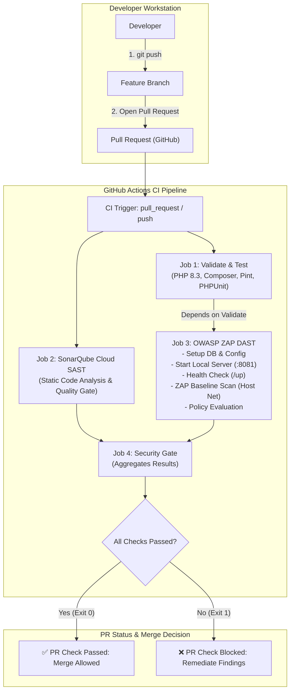

# GitHub CI/CD Security Pipeline Documentation: SonarQube Cloud (SAST) & OWASP ZAP (DAST)

This guide documents the enterprise-grade CI/CD security pipeline designed for the **Concert Ticket System** and its mock payment gateway service (**PayMock**), as well as multi-repository adoption across organizational microservices.

---

## Table of Contents

1. [Overview](#1-overview)
2. [Architecture](#2-architecture)
3. [Prerequisites](#3-prerequisites)
4. [SonarQube Cloud Setup](#4-sonarqube-cloud-setup)
5. [OWASP ZAP Setup](#5-owasp-zap-setup)
6. [Git Setup & Developer Guide](#6-git-setup--developer-guide)
7. [GitHub Repository Settings & Branch Protection](#7-github-repository-settings--branch-protection)
8. [Pull Request Workflow](#8-pull-request-workflow)
9. [Security Reports & Artifacts](#9-security-reports--artifacts)
10. [Troubleshooting Guide](#10-troubleshooting-guide)
11. [Limitations of Automated Security Scans](#11-limitations-of-automated-security-scans)
12. [Pipeline Maintenance & Upgrades](#12-pipeline-maintenance--upgrades)
13. [Multi-Repository Reusable Pipeline Architecture](#13-multi-repository-reusable-pipeline-architecture)

---

## 1. Overview

### What the Security Pipeline Does
The CI/CD security pipeline automatically evaluates source code and live application runtime behavior whenever a developer opens, updates, or reopens a Pull Request (PR) targeting protected branches (`main`, `development`). It enforces automated security gates to catch vulnerabilities before any code can be merged into production or shared branches.

### SAST vs. DAST: A Defense-in-Depth Approach

| Feature | SAST (Static Application Security Testing) | DAST (Dynamic Application Security Testing) |
|---|---|---|
| **Tool Used** | **SonarQube Cloud** | **OWASP ZAP** (Zed Attack Proxy) |
| **Analysis Target** | Source code, configuration, dependency declarations | Running application over HTTP/HTTPS |
| **Perspective** | White-Box (inside looking in) | Black-Box (outside looking in) |
| **When It Runs** | At compile/static stage (no running server needed) | At runtime against a live instance |
| **Key Findings** | Insecure functions, SQL injection flaws, hardcoded credentials, code smells, syntax anti-patterns | Missing security headers (CSP, HSTS), Cookie security, CORS misconfigurations, server info leakage |
| **Execution Speed** | Fast (seconds to a few minutes) | Moderate (crawling + passive checks) |

### Why Scan Before Merging?
Remediating vulnerabilities in production can cost up to 30x more than catching them during the development phase. By embedding both SAST and DAST into the Pull Request workflow:
- Developers receive immediate feedback while context is fresh.
- Sensitive credentials or secrets cannot accidentally enter the main branch history.
- Compliance and security standards are enforced automatically without requiring manual gatekeeping for every minor change.

---

## 2. Architecture

The pipeline orchestrates testing and security validation using GitHub Actions jobs running in parallel and sequenced stages.



---

## 3. Prerequisites

Before running the pipeline, ensure the following are prepared:

1. **GitHub Repository**: Admin access to `Team3-SE/Concert-Ticket-System` (or your organizational repository).
2. **SonarQube Cloud Account**: An account on [SonarQube Cloud](https://sonarcloud.io) connected to your GitHub account or organization (`team3-se`).
3. **Repository Secrets**:
   - `SONAR_TOKEN`: User or project token generated from SonarQube Cloud.
   - `APP_ENV_FILE` (Optional): Custom `.env` definitions if runner overrides are needed.
4. **Local Tools (for Developers)**:
   - Git (v2.30+)
   - PHP 8.2 or 8.3 with SQLite PDO extensions
   - Composer (v2.x)
   - Docker Desktop (Optional, for running full containerized local tests)

---

## 4. SonarQube Cloud Setup

### Step 1: Create Organization & Project in SonarQube Cloud
1. Navigate to [https://sonarcloud.io](https://sonarcloud.io) and log in using your **GitHub account**.
2. Click the `+` icon in the top navigation bar and select **Analyze new project**.
3. Select your GitHub organization (e.g. `team3-se` or your personal user account). If prompted, grant SonarCloud permissions to access the repository `Team3-SE/Concert-Ticket-System`.
4. Select `Concert-Ticket-System` and click **Set Up**.
5. When asked *How do you want to analyze your repository?*, select **With GitHub Actions**.

### Step 2: Obtain Project Key and Organization Key
- Locate the **Project Key** and **Organization Key** shown on the setup screen:
  - **Organization Key**: `team3-se`
  - **Project Key**: `Team3-SE_Concert-Ticket-System`
- Ensure these match `sonar-project.properties` in your repository root:
  ```properties
  sonar.organization=team3-se
  sonar.projectKey=Team3-SE_Concert-Ticket-System
  sonar.projectName=Concert-Ticket-System
  sonar.sources=paymock/app,paymock/routes,paymock/resources,paymock/config,paymock/public
  sonar.tests=paymock/tests
  ```

### Step 3: Generate SonarQube Cloud Token
1. In SonarQube Cloud, click your user avatar (top right) $\to$ **My Account** $\to$ **Security**.
2. In the **Generate Token** section:
   - Enter Name: `github-actions-concert-system`
   - Type: `User Token` (or `Project Analysis Token`)
   - Expiration: Choose your team's rotation policy (e.g., 90 days or No expiration)
3. Click **Generate** and immediately copy the token value (e.g., `sqp_1234567890abcdef...`).

### Step 4: Add GitHub Repository Secret
1. In GitHub, open the repository: `https://github.com/Team3-SE/Concert-Ticket-System`.
2. Go to **Settings** $\to$ **Secrets and variables** $\to$ **Actions**.
3. Under **Repository secrets**, click **New repository secret**.
4. Set:
   - **Name**: `SONAR_TOKEN`
   - **Secret**: Paste the copied SonarQube token.
5. Click **Add secret**.

### Step 5: Configure the Quality Gate
1. In SonarQube Cloud, open the project dashboard and click **Quality Gate**.
2. By default, the **Sonar way** quality gate is applied (requires 0 new vulnerabilities, 0 security hotspots reviewed, and clean new code).
3. Under **Administration** $\to$ **Analysis Method**, ensure **Automatic Analysis** is toggled **OFF** so that GitHub Actions controls analysis execution.

---

## 5. OWASP ZAP Setup

### What OWASP ZAP Does in the Pipeline
The pipeline runs the official **OWASP ZAP Baseline Scan** (`zaproxy/action-baseline@v0.15.0`) against the locally running web service inside the GitHub Actions runner.

### How the Local Application is Started in CI
Because security testing should not require deploying unverified code to public staging or production servers, the pipeline:
1. Provisions the PHP 8.3 runtime on the runner VM.
2. Runs Composer dependency installation (`composer install`).
3. Prepares the environment: copies `.env.example`, generates `APP_KEY`, and runs database migrations on an isolated SQLite database (`paymock.sqlite`).
4. Starts the local server in the background:
   ```bash
   nohup php artisan serve --host=127.0.0.1 --port=8081 > /tmp/app_server.log 2>&1 &
   ```
5. Polls the application's built-in health check endpoint (`http://127.0.0.1:8081/up`) until HTTP 200 is confirmed (with configurable timeout).

### Scanner Network Architecture: Docker Host Networking
The OWASP ZAP Docker container executes on the runner VM with:
```bash
--network="host"
```
This enables the containerized ZAP proxy to access `http://127.0.0.1:8081` on the runner without NAT routing issues or port forwarding overhead.

### What the Baseline Scan Checks
- HTTP Strict Transport Security (HSTS) headers.
- Content Security Policy (CSP) presence and configuration.
- Anti-CSRF token implementation.
- X-Content-Type-Options (`nosniff`).
- Sensitive information leakage in HTTP headers (e.g. `Server`, `X-Powered-By`).
- Insecure cookie configurations (missing `HttpOnly`, `SameSite`, or `Secure` flags).
- Sensitive files or directory listing exposure.

### Severity Failure Policy
The pipeline includes an automated Python evaluation step that parses `report_json.json` and enforces configurable failure thresholds:
- `critical`: Fails CI if any Critical vulnerabilities are found.
- `high` (Default): Fails CI if any High or Critical vulnerabilities are found.
- `medium`: Fails CI if Medium, High, or Critical vulnerabilities are found.
- `none`: Generates reports without blocking PR completion (report only).

Custom rules can be tuned via `.zap/rules.tsv` to prevent false positives.

---

## 6. Git Setup & Developer Guide

### Fresh Clone Setup

#### On Linux / macOS / WSL
```bash
# 1. Configure user identity
git config --global user.name "Your Name"
git config --global user.email "your.email@example.com"

# 2. Clone repository
git clone https://github.com/Team3-SE/Concert-Ticket-System.git
cd Concert-Ticket-System

# 3. Check remote and fetch all branches
git remote -v
git fetch origin

# 4. Check status
git status
```

#### On Windows (PowerShell)
```powershell
# 1. Configure user identity
git config --global user.name "Your Name"
git config --global user.email "your.email@example.com"
git config --global core.autocrlf true

# 2. Clone repository
git clone https://github.com/Team3-SE/Concert-Ticket-System.git
Set-Location Concert-Ticket-System

# 3. Fetch branches
git fetch origin
git status
```

### Developing on a Feature Branch

Always branch off `development` (or `main` according to team conventions):

```bash
# 1. Switch to development and pull latest changes
git checkout development
git pull origin development

# 2. Create your feature branch
git checkout -b feature/secure-payment-validation

# 3. Make changes and verify status
git status

# 4. Commit changes with semantic commit messages
git add .
git commit -m "feat(security): add security headers and sanitize input"

# 5. Push feature branch to GitHub
git push -u origin feature/secure-payment-validation
```

### Pulling Updates & Resolving Conflicts
If `development` was updated by team members while you were working:
```bash
# Fetch latest commits from remote
git fetch origin

# Rebase or merge development into your feature branch
git merge origin/development

# If conflicts occur:
# 1. Open conflicted files and resolve markers (<<<<<<<, =======, >>>>>>>)
# 2. Stage resolved files
git add <resolved-file>
# 3. Complete the merge commit
git commit -m "chore: resolve merge conflicts with origin/development"
git push origin feature/secure-payment-validation
```

---

## 7. GitHub Repository Settings & Branch Protection

To enforce security checks before code can be merged into `development` or `main`:

### 1. Actions Permissions
1. Navigate to **Settings** $\to$ **Actions** $\to$ **General**.
2. Under **Workflow permissions**, choose **Read repository contents and packages permissions**.
3. Check the box **Allow GitHub Actions to create and approve pull requests** only if required by bots; otherwise keep unchecked.
4. Save changes.

### 2. Configure Branch Protection Rules
1. Navigate to **Settings** $\to$ **Branches**.
2. Click **Add branch protection rule** (or edit existing rule for `development` / `main`).
3. Set **Branch name pattern**: `development` (and repeat for `main`).
4. Enable the following controls:
   - **Require a pull request before merging**:
     - Check *Require approvals* (minimum 1 review).
     - Check *Dismiss stale pull request approvals when new commits are pushed*.
   - **Require status checks to pass before merging**:
     - Check *Require branches to be up to date before merging*.
     - In the search bar for status checks, enter the exact check names:
       - `4. Security Gate / Overall Status` *(Primary unified gate)*
       - `1. Validate & Test`
       - `2. SonarQube Cloud SAST`
       - `3. OWASP ZAP DAST Analysis`
   - **Do not allow bypassing the above settings**: Enforce rules for administrators.
   - **Restrict who can push to matching branches**: Prevent direct pushes (all changes must go through PR).
5. Click **Save changes**.

> [!NOTE]
> **How to find exact check names**: The status check names appear in the branch protection search bar only **after** the workflow has run at least once on a Pull Request or push. Trigger the workflow manually via `workflow_dispatch` or create a test PR first.

---

## 8. Pull Request Workflow

Here is the complete development and automated security evaluation lifecycle:

```
Developer Workstation               GitHub Actions                   SonarQube & ZAP               Merge Authority
       |                                   |                                |                            |
       |--- git push origin feature/... -->|                                |                            |
       |--- Create Pull Request ---------->|                                |                            |
       |                                   |--- Job 1: Validate & Tests --->|                            |
       |                                   |--- Job 2: SonarQube SAST ----->| (Static analysis)          |
       |                                   |    [Wait for Quality Gate] <---| (Quality Gate result)      |
       |                                   |--- Job 3: OWASP ZAP DAST ----->| (Boot app & spider scan)   |
       |                                   |    [Collect & evaluate]   <----| (HTML & JSON reports)      |
       |                                   |--- Job 4: Security Gate ------>|                            |
       |<-- Step Summary & Status Checks --|                                |                            |
       |                                                                                                 |
[If Failure: Fix issues & push new commit; workflow reruns automatically]                                |
       |                                                                                                 |
[If Passed: All checks green] ------------------------------------------------------------------------->|
                                                                                                         |-- PR Approved & Merged
```

1. **Feature Creation**: Developer creates branch `feature/xyz` and implements changes.
2. **Push & PR**: Developer pushes branch and opens a Pull Request to `development`.
3. **Automated CI Run**:
   - `Validate & Test`: Runs Pint linter and PHPUnit test suite.
   - `SonarQube SAST`: Scans codebase for code smells, bugs, and static security vulnerabilities.
   - `OWASP ZAP DAST`: Boots PayMock on port 8081, runs passive baseline scan, and checks findings against the threshold.
4. **Security Gate**: Aggregates all check statuses into a formatted GitHub Step Summary.
5. **Review & Merge**: Reviewers see the green `Security Gate / Overall Status` check and approve merge.

---

## 9. Security Reports & Artifacts

### 1. GitHub Actions Execution Logs & Step Summary
- Open the Pull Request on GitHub.
- Click the **Checks** tab or the **Details** link next to the workflow run.
- Select **Security Gate / Overall Status** to view the consolidated table of results.
- Select **OWASP ZAP DAST Analysis** to view the detected alerts broken down by High, Medium, Low, and Informational counts.

### 2. SonarQube Cloud Dashboard
- Log in to [https://sonarcloud.io](https://sonarcloud.io).
- Open the project: `Team3-SE_Concert-Ticket-System`.
- Under the **Pull Requests** tab, select the specific PR number.
- Inspect the **Quality Gate** status, new issues, duplicated lines, and code coverage.

### 3. Downloading OWASP ZAP Artifacts
- On the GitHub Actions run summary page, scroll down to the **Artifacts** section.
- Click **`owasp-zap-dast-reports`** to download a ZIP archive containing:
  - `report_html.html`: Full visual report with vulnerability descriptions and remediation guidance.
  - `report_json.json`: Machine-readable scan data.
  - `report_md.md`: Markdown summary.

---

## 10. Troubleshooting Guide

### 1. `SONAR_TOKEN` is invalid or missing
- **Symptom**: `ERROR: Not authorized. Please check the value of the SONAR_TOKEN environment variable.`
- **Fix**: Verify `SONAR_TOKEN` is added under **Settings** $\to$ **Secrets and variables** $\to$ **Actions**. If rotated, generate a new User Token in SonarCloud and update the secret.

### 2. Sonar project key or organization key incorrect
- **Symptom**: `Project not found. Please check organization and project keys.`
- **Fix**: Confirm `sonar.projectKey` and `sonar.organization` in `sonar-project.properties` match the exact casing in SonarQube Cloud.

### 3. Quality Gate check times out
- **Symptom**: `SonarQube Quality Gate Check timed out after 300 seconds.`
- **Fix**: Check SonarQube Cloud background tasks for server backlog. Increase `pollingTimeoutSec` in the workflow if your repository has a large codebase.

### 4. Sonar analysis cannot identify PR
- **Symptom**: Analysis runs against `main` instead of the PR branch.
- **Fix**: Ensure `actions/checkout@v4` uses `fetch-depth: 0` so Git history and PR refs are fully available.

### 5. Dependency installation fails
- **Symptom**: `composer install` fails with PHP version or extension conflicts.
- **Fix**: Ensure `shivammathur/setup-php@v2` specifies required extensions: `pdo, sqlite, pdo_sqlite, mbstring, curl, gd, zip`.

### 6. Local application fails to start
- **Symptom**: `ERROR: Application failed to respond within 60s!`
- **Fix**: Check the printed `/tmp/app_server.log` in the CI step output. Ensure `.env` exists (`cp -n .env.example .env`) and `APP_KEY` was generated (`php artisan key:generate`).

### 7. Application health check times out
- **Symptom**: App starts but `curl -s -f http://127.0.0.1:8081/up` fails.
- **Fix**: Verify route `/up` is registered in `routes/web.php` and does not require session or CSRF middleware.

### 8. ZAP cannot connect to localhost
- **Symptom**: ZAP reports `ZAP failed to access the target URL http://127.0.0.1:8081`.
- **Fix**: Confirm `network_name: host` is set on `zaproxy/action-baseline`. On Linux runners, host networking allows the Docker container to reach host ports directly.

### 9. Port conflict
- **Symptom**: `Address already in use` when starting artisan serve.
- **Fix**: Use a dedicated port (e.g., `8081` instead of `80` or `8000`) or dynamically pass `app_port`.

### 10. Missing environment variables
- **Symptom**: App throws `500 Server Error` due to missing database or API keys.
- **Fix**: Pass custom environment variables via `APP_ENV_FILE` secret or verify `.env.example` contains appropriate defaults.

### 11. Database unavailable
- **Symptom**: `Database file does not exist` or `PDOException: driver not found`.
- **Fix**: In the `pre_start_command`, run `touch database/paymock.sqlite && php artisan migrate --force`.

### 12. Scan reports not uploaded
- **Symptom**: Workflow fails and no ZAP report artifact is available.
- **Fix**: Ensure the upload step uses `if: always()` so reports are uploaded even when tests or security checks fail.

### 13. Required status check does not appear in GitHub settings
- **Symptom**: `4. Security Gate / Overall Status` cannot be found in the Branch Protection search box.
- **Fix**: Trigger the workflow once by pushing to a branch or using the **Run workflow** button under **Actions** tab. GitHub only registers status check names after their first invocation.

---

## 11. Limitations of Automated Security Scans

While automated SAST and DAST provide strong baseline protection, team members should understand their boundaries:

1. **Business Logic Vulnerabilities**: Automated scanners cannot detect flaws in business workflows (e.g. purchasing a concert ticket with a negative quantity or skipping payment verification steps).
2. **Access Control & Authorization**: Scanners cannot verify whether User A can view User B's private tickets without tailored authenticated crawling.
3. **False Positives & Negatives**:
   - SAST may flag harmless code patterns as vulnerabilities (false positives).
   - DAST only checks paths it crawls; unlinked API endpoints will not be tested unless an OpenAPI/Postman specification is supplied.
4. **Active Penetration Testing**: Baseline DAST only conducts passive checks. Aggressive active attacks (SQLi fuzzing, CSRF exploitation) are intentionally avoided during PR checks to prevent pipeline slowdowns and state corruption.
5. **No Guarantee of Absolute Security**: Passing all CI security checks is a prerequisite for merging, but does not substitute for code review, secure design reviews, and periodic manual penetration testing.

---

## 12. Pipeline Maintenance & Upgrades

### Updating Action Versions
Regularly check for updates to official actions:
- `actions/checkout`: Check [GitHub Releases](https://github.com/actions/checkout/releases).
- `SonarSource/sonarqube-scan-action`: Check [Releases](https://github.com/SonarSource/sonarqube-scan-action/releases).
- `zaproxy/action-baseline`: Check [Releases](https://github.com/zaproxy/action-baseline/releases).

### Changing Failure Severity Threshold
To tighten or relax DAST enforcement, update `fail_on_severity` in your caller workflow:
```yaml
with:
  fail_on_severity: "critical" # Less strict: only fail on critical
  # fail_on_severity: "high"   # Default: fail on high & critical
  # fail_on_severity: "medium" # Stricter: fail on medium, high & critical
```

### Rotating Secrets
1. Generate a new token in SonarQube Cloud.
2. In GitHub, go to **Settings** $\to$ **Secrets and variables** $\to$ **Actions**.
3. Update `SONAR_TOKEN` with the new value. The next workflow run will use the new credential immediately.

### Disabling Workflow Safely in Emergency
If a third-party outage blocks merging of critical hotfixes:
1. In repository **Settings** $\to$ **Branches**, temporarily uncheck `4. Security Gate / Overall Status` from required status checks.
2. Complete the urgent hotfix PR.
3. Re-enable the required status check immediately after the incident is resolved.

---

## 13. Multi-Repository Reusable Pipeline Architecture

The security pipeline is architected around GitHub's `workflow_call` mechanism. This enables any repository across the organization to adopt identical security scanning standards with minimal configuration.

### Reusable Workflow Location
- Central Workflow: `.github/workflows/reusable-security-pipeline.yml`

### How Other Repositories Connect
In other repositories, create a `.github/workflows/security.yml` that references the central reusable workflow:

```yaml
jobs:
  security:
    uses: Team3-SE/Concert-Ticket-System/.github/workflows/reusable-security-pipeline.yml@main
    with:
      app_port: 3000
      app_start_command: "npm start"
      zap_target: "http://127.0.0.1:3000"
      sonar_project_key: "org_service-name"
      sonar_organization: "team3-se"
      runtime: "node"
      runtime_version: "20"
      install_command: "npm ci"
      test_command: "npm test"
      health_check_url: "http://127.0.0.1:3000/health"
    secrets:
      SONAR_TOKEN: ${{ secrets.SONAR_TOKEN }}
```

Complete caller templates for **PHP/Laravel**, **Node.js**, and **Python API** are available in the [`docs/examples/`](file:///mnt/c/Github/Concert-P-Tum/docs/examples/) directory.
